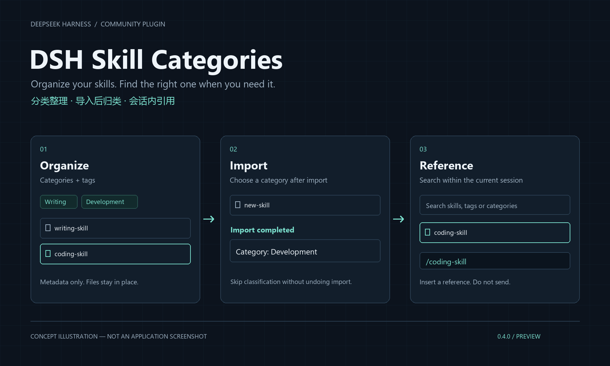
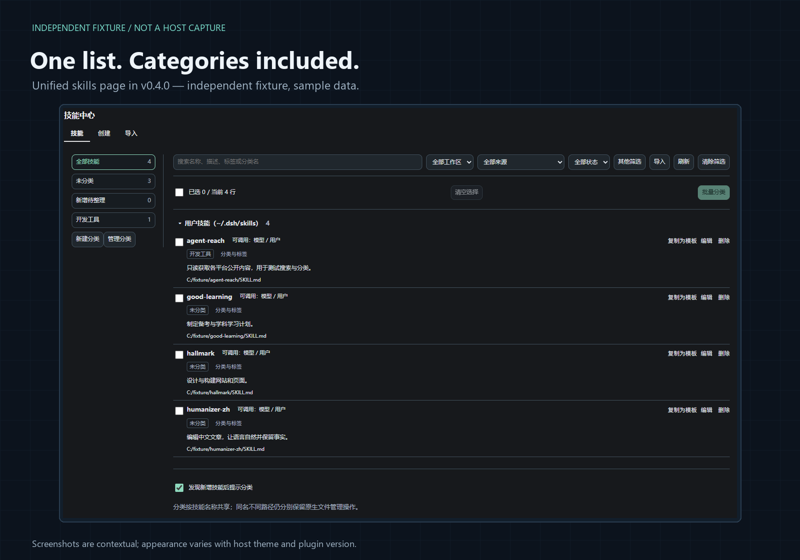
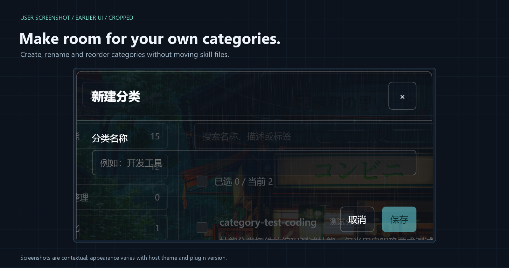
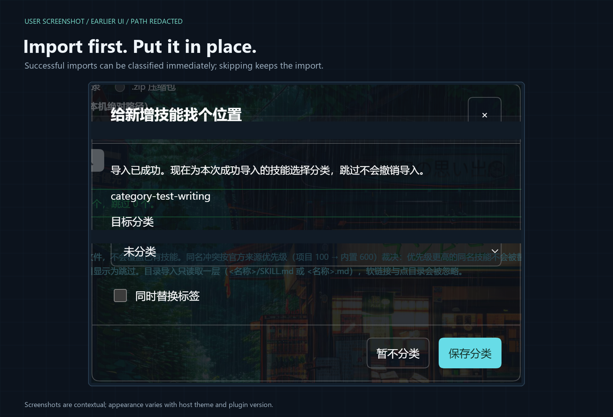
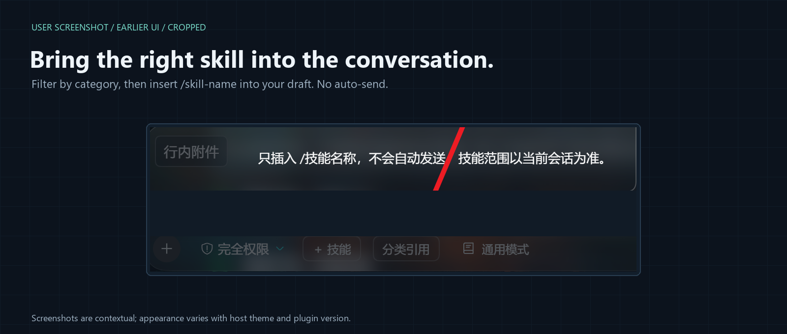

# dsh-skill-categories

### A DSH skill center with categories

[简体中文](README.md) · [Validation record](VALIDATION.md) · [Third-party notices](THIRD_PARTY_NOTICES.md)

[](https://github.com/wuzeno/dsh-skill-categories/actions/workflows/ci.yml)

Once a skill collection grows, remembering what a skill does is easier than remembering its name. This plugin adds categories, tags, and batch organization to the DeepSeek Harness skill center, so you can find skills by purpose while managing, importing, or referencing them.



*Feature illustration, not a screenshot of the running application.*

> **Preview · 0.4.0**
>
> The build, automated tests, and a standalone browser fixture have been checked. Full acceptance testing in an authenticated DSH host is still incomplete. Try it with test skills first and back up important data. See the compatibility and validation sections below.

## Organize skills in one view

There is no separate classification tab in 0.4. The unified **Skills** view has a category rail alongside the original file/provider inventory and its enable, edit, delete, and duplicate-as-template actions. **Create** and **Import** remain separate tabs; **Edit** appears when needed.

- **Custom categories and tags.** Create, rename, reorder, or delete categories. Deleting a category removes the assignment, not the skill file or its tags.
- **Batch organization.** Select skills and assign them together. Existing tags are preserved unless you explicitly choose to replace them. Selections hidden by filters or collapsed groups are excluded from batch actions.
- **Combined filters.** Narrow the list by category, workspace, source, enabled state, and file markers. Search matches names, descriptions, tags, and category names.
- **Classification after import.** After a directory or ZIP import succeeds, choose a category for the successfully imported items. Skipping classification does not undo the import; skipped import items are not included in that prompt.
- **Category-based references in conversations.** A separate **分类引用** button lets you find a skill by category and insert its reference without sending the message.



*0.4 standalone fixture — Sample / not host. Uses sample data; this is not an acceptance-test screenshot from an authenticated host.*

## Categories and tags

Create a category in the skill center, then select skills for batch assignment or use the **分类与标签** action on a row. Choosing a category narrows the same management list; there is no second inventory to maintain.



*User-provided screenshot from an earlier version, cropped and redacted. Version 0.4 combines Skills and Classification; this close-up shows the operation, not the current complete layout.*

Assignments are keyed by the **logical skill name**. Skills with the same name share categories and tags across workspaces and paths, while their individual file rows and management actions remain available. Skills with nonstandard names can still be browsed and managed, but cannot currently be classified.

The workspace selector filters the list. It does not switch your active workspace or select an agent preset. Globally shared skills remain visible within a selected workspace.

## Classify after importing

Use this plugin's **Import** tab to import a local directory or ZIP file. After a successful response, the plugin combines the items actually imported into one classification prompt; it does not wait for background polling. A classification-save failure does not turn a successful import into a failed one or roll back skill files.



*User-provided screenshot from an earlier version, cropped and redacted. Version 0.4 combines Skills and Classification; this close-up shows the operation, not the current complete layout.*

You can also enable or disable prompts for newly discovered skills. New names introduced through another plugin, manual copying, or a preset change are detected from complete catalog scans, roughly every 10 seconds. A background page or another open modal can delay the prompt. The first successful scan establishes a baseline rather than prompting for the entire existing collection.

Polling does not prompt again merely because a known name disappears and returns. Explicit imports in this view are deduplicated during the current client run. An incomplete scan preserves the last complete result and does not erase assignments.

## Category-based references in the composer

Open **分类引用** to choose all categories, uncategorized skills, or a custom category. You can also search by category name, tag, skill name, or description. The skill marketplace plugin's original **＋技能** button is left unchanged.



*User-provided screenshot from an earlier version, cropped and redacted. Version 0.4 combines Skills and Classification; this close-up shows the operation, not the current complete layout.*

Candidates come from the **current conversation's** user-invocable skill catalog, respecting its preset and workspace scope. This is different from the management view's file/provider inventory, so the two views can legitimately show different counts.

Picking a skill uses the host's safe insertion interface to insert `/skill-name ` at the current insertion position. It does not send the message or replace the whole draft. If the host rejects the insertion, the picker reports an error rather than falling back to overwriting the draft. Escape closes the dialog and restores focus to its button.

A skill that is user-invocable but not model-invocable can still be referenced. The button is hidden in subagent conversations. It is not mounted when optional conversation services are unavailable, and is disabled when the host lacks a safe insertion interface. If more than 200 results match, refine the search to see the remaining items.

## Installation

### Requirements

- DeepSeek Harness: `>=0.2.1-rc.3 <0.3.0`
- Node.js: `>=22.13.0`
- Building from source requires pnpm and the repository's lockfile.

These are the declared compatibility ranges, not a claim that every host version and third-party plugin combination has been tested.

> **Do not enable the original skill center and this plugin at the same time.**
>
> Before enabling this integrated version, disable `@linxin666/dsh-client-ui-skill-explorer` in the official plugin manager to avoid duplicate entries and management routes. You may keep the original package installed for rollback. This plugin does not take over other skill marketplace plugins.

### Install from source

This project has not been published to npm. No unverified remote npm installation command is provided.

Download or clone this repository, then run these commands in the project root:

```sh
git clone https://github.com/wuzeno/dsh-skill-categories.git
cd dsh-skill-categories
pnpm install --frozen-lockfile --ignore-scripts
npm run build
npm run check
npm test
```

Use the **official DSH plugin manager** to install the local `dsh-skill-categories` project directory. Do not manually edit your user profile or start a separate web server. Refresh the existing DSH page after installation, or restart DSH if the host asks you to.

Local-directory installation commonly uses a link, so dependencies must also be installed in the source directory; otherwise the host may not be able to resolve `zod`. Check both package installation and plugin activation results.

### Upgrade and rollback

If the manager reports `already-installed`, remove the old bundle through the official manager and install the updated local directory. The classification domain and schema remain unchanged, but the host controls whether data survives removal. Back up important data first.

To roll back, disable this plugin, enable the original skill center, and refresh the page. Do not enable both together. Upgrading this plugin does not migrate skill files; classification features are unavailable while it is disabled.

## Data and behavior boundaries

| Action | Effect |
| --- | --- |
| Categories, tags, and batch assignments | Stored in this plugin's `skill_categories` domain. Does not move skill directories or rewrite skill content. |
| Delete a category | Skills become uncategorized. Files and tags remain. |
| Original skill-management actions | Create, import, edit, delete, and file-skill toggles retain the original skill center's behavior and may change files or panel settings. |
| Provider-skill toggles | The original panel may only record a local panel state; this does not guarantee that the provider's model invocation is disabled. |
| Category-based reference | Selects from the current conversation's invocable catalog and inserts a reference without sending the message. |

Categories do not restrict the agent's available skills, select skills automatically, or load an entire category. There is currently no AI auto-classification, nested categories, cross-device synchronization, or classification import/export.

The unified management list uses the original panel's file/provider inventory, retaining disabled skills and same-name files at different paths. Classification metadata is attached to that inventory rather than replacing it with the default preset's catalog. External discovery prompts use complete snapshots from the default preset and cannot guarantee discovery of every provider or on-disk copy. Presets whose completeness cannot be established are treated as incomplete; unknown third-party private isolation remains a compatibility boundary.

## Validation status

The 0.4.0 development record includes:

- Successful build and syntax checks for the host and production client.
- **80 automated tests passed, with no failures or skips**, covering classification, persistence, conflicts, catalog completeness, conversation references, and the unified list.
- A standalone browser fixture checked category creation, batch assignment, the unified inventory, and compact controls. Earlier fixture checks covered post-import prompts and safe reference insertion.

The fixture does not perform real host file operations. The automation browser did not complete host authentication during development, so these results **are not a full real-host acceptance test**. Real import, edit, delete, and retention of existing assignments across upgrades still need to be checked in an authenticated environment. See the [validation record](VALIDATION.md).

Images are labeled as feature illustrations, a 0.4 standalone sample, or user-provided close-ups from an earlier version. Earlier screenshots may have different tabs and layouts. None of these images replaces full host acceptance testing.

## Development

```sh
npm run build
npm run check
npm test
```

Generate a standalone local fixture:

```sh
node scripts/preview.mjs
```

Open the generated `preview/index.html` to inspect sample data. It is not an authenticated DSH page.

Build a distributable package:

```sh
pnpm pack
```

Key source locations:

| Path | Purpose |
| --- | --- |
| [`src/service.js`](src/service.js) | Classification storage, validation, and shared operations |
| [`src/unified.js`](src/unified.js) | Unified skill view and filters |
| [`src/picker.js`](src/picker.js) | Current-conversation catalog lookup and safe reference insertion |
| [`scripts/adapt-explorer.mjs`](scripts/adapt-explorer.mjs) | Build-time adaptation of the pinned upstream client |
| [`vendor/skill-explorer`](vendor/skill-explorer) | Pinned upstream copies, provenance, and license |
| [`test`](test) | Automated tests |

The build uses local code and styles without a client CDN. Production UI uses the host-provided React instance. Requests, polling, and slot registrations are cleaned up on unload. Classification writes are serialized and committed to memory only after persistence succeeds; conflicts refresh the state rather than blindly replaying the write.

The classification API accepts the required request format only from the current authenticated browser peer, and workspace paths must be registered with the host. The original skill-management route checks and file-operation rules remain upstream behavior; this project has not replaced their security model. The upstream client's telemetry and standalone mounting entry points are not executed. This plugin does not upload skill content or depend on third-party online services.

## Feedback and distribution

When reporting an issue, include your DSH and plugin versions, reproduction steps, expected and actual behavior, and any necessary screenshots. Do not include login links, tokens, personal attachments, or sensitive skill content.

Public distributions should retain source, build scripts, tests, the lockfile, and all licenses. Do not upload `node_modules`, user profiles, or generated fixture files; see [`.gitignore`](.gitignore). Before relying on the plugin, test import, editing, classification persistence, and conversation references in your own authenticated DSH environment.

## Attribution and licenses

The skill-management functionality is based on **[`@linxin666/dsh-client-ui-skill-explorer` 0.4.8](https://github.com/zhu1090093659/dsh-web)** by **zhu1090093659**, licensed under **BSD-3-Clause**. Its copyright notice, redistribution conditions, and disclaimer are retained in this repository and the distributable package.

Original classification, unified-view, reference, adaptation, and test code in this project is licensed under [MIT](LICENSE). Upstream code remains under its [BSD-3-Clause license](vendor/skill-explorer/LICENSE); MIT does not replace those terms. This project is not an official DeepSeek project and does not claim endorsement by DeepSeek or the upstream author.

See the [third-party notices](THIRD_PARTY_NOTICES.md) and [upstream integration notes](vendor/skill-explorer/README.md).
