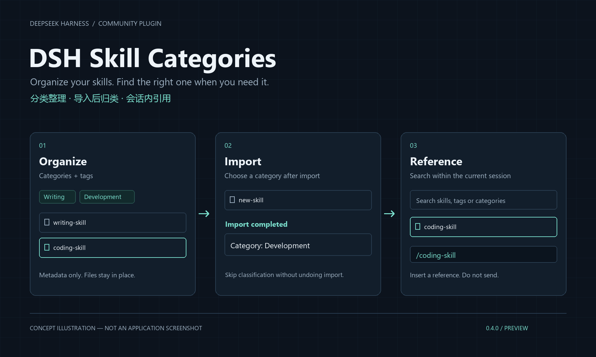
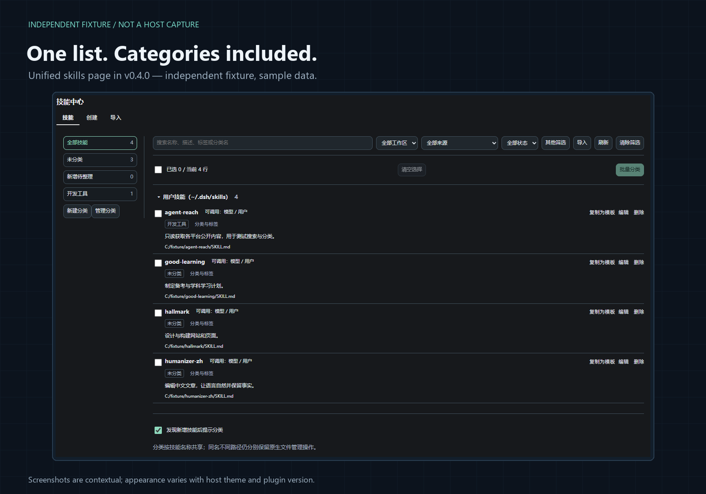
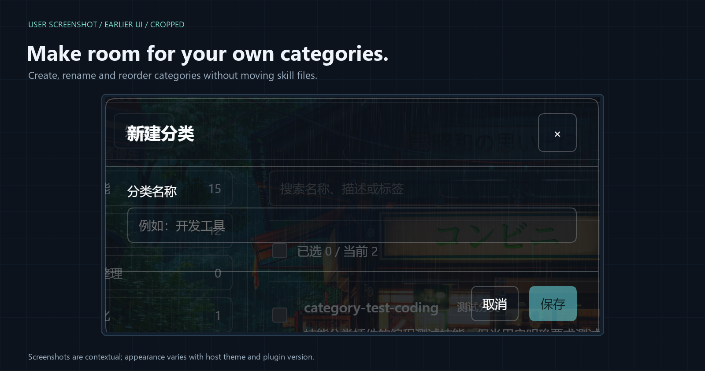
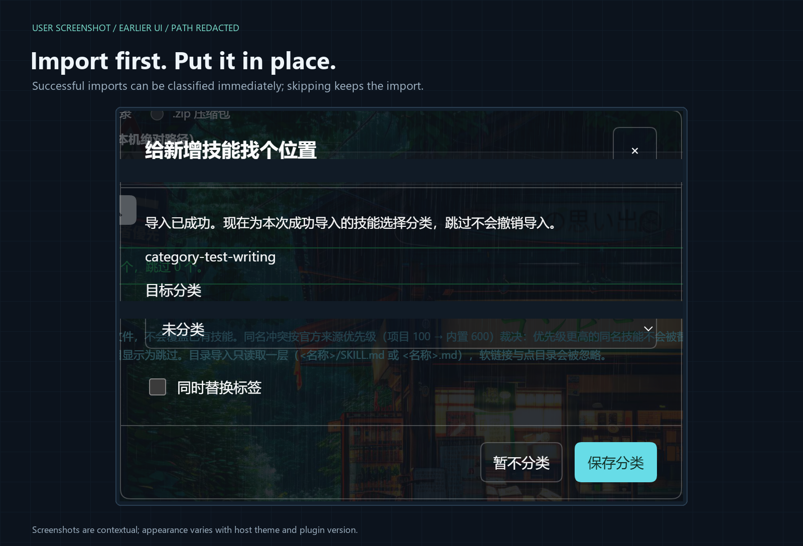
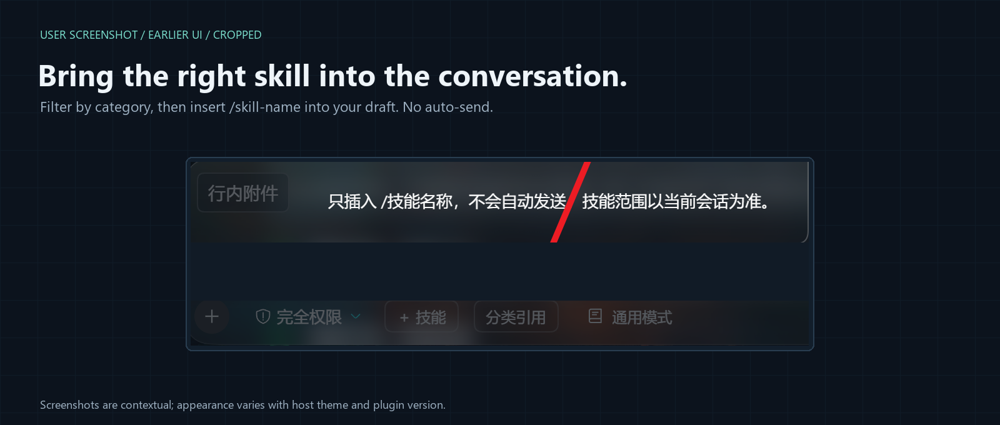

# dsh-skill-categories

### DSH 技能中心 · 分类增强

[English](README.en.md) · [验证记录](VALIDATION.md) · [第三方声明](THIRD_PARTY_NOTICES.md)

[](https://github.com/wuzeno/dsh-skill-categories/actions/workflows/ci.yml)

技能装多了，记得名字和记得用途是两回事。这个插件把分类、标签和批量整理放进 DeepSeek Harness 的技能中心，让你在管理、导入和引用技能时都能按用途查找。



*上图为功能示意，不是真实界面截图。*

> **预览版 · 0.4.0**
>
> 当前已完成构建、自动测试和独立浏览器示例验证，但尚未完成完整的已登录宿主验收。请先用测试技能试用，并备份重要数据。支持范围与已知限制见下文。

## 在一个技能页里完成整理

不再分别维护「技能」和「分类整理」两份列表。统一的「技能」页左侧选择分类，右侧保留原有的文件与提供者目录，以及启用、编辑、删除、复制模板等操作；「创建」「导入」仍是独立页签，编辑时显示编辑页签。

- **自定义分类与标签**：新建、重命名、排序、删除分类；删除分类只取消归类，技能文件和标签保留。
- **批量整理**：勾选后一起归类，标签默认保留，明确选择替换后才覆盖。当前筛选或折叠组中隐藏的勾选项不会被批量处理。
- **联合筛选**：按分类、工作区、来源、启用状态和文件标记缩小范围；搜索同时匹配技能名称、描述、标签与分类名。
- **导入后归类**：目录或 ZIP 导入成功后，为本次成功导入的技能选择分类。跳过归类不会撤销导入，已跳过的导入项目不加入本次提示。
- **在会话里按分类引用**：输入框新增独立的「分类引用」按钮，选中技能后只插入引用，不自动发送消息。



*0.4 独立示例界面（Sample / not host），使用示例数据，不是已登录宿主的验收截图。*

## 分类整理

在技能中心新建分类，勾选技能后点击「批量分类」，或使用技能行中的「分类与标签」。选择左侧分类即可查看相应技能，不需要离开当前管理页。



*用户提供的早期版本截图，已裁剪并脱敏；0.4 已将「技能」与「分类整理」合并。此处仅展示操作特写，不代表当前完整布局。*

分类以**技能逻辑名称**为键。同名技能即使位于不同工作区或路径，也共用一份分类和标签；管理列表仍保留各自的文件行与操作。非标准命名的技能可以继续浏览和管理，但暂不支持分类。

「工作区」是列表筛选器，不会切换正在使用的工作区，也不是 Agent 预设选择器。全局共享技能在所选工作区中仍然可见。

## 导入时顺手归类

在本插件的「导入」页选择本地目录或 ZIP。导入成功后，插件根据本次响应中实际成功的项目合并提示归类，不需要等待后台轮询。分类保存失败不会把成功导入改成失败，也不会回滚技能文件。



*用户提供的早期版本截图，已裁剪并脱敏；0.4 已将「技能」与「分类整理」合并。此处仅展示操作特写，不代表当前完整布局。*

还可以开启或关闭「发现新增技能后提示分类」。通过其他插件、手工复制或预设变化出现的新名称，采用约 10 秒一轮的完整目录检测；后台页面或其他模态窗口可能延迟提示。首次读取只建立已有目录基线，不会把全部旧技能集中弹出。

检测不会因为已知名称被删除后重新出现而重复提示；本页明确导入的名称在当前客户端运行期间去重。不完整扫描保留上次完整结果，不会据此清空分类。

## 输入框里的「分类引用」

打开「分类引用」，可选择全部分类、未分类或自定义分类，也可以直接输入分类名、标签、技能名称或描述中的词。原技能市场插件的「＋技能」按钮不会被替换。



*用户提供的早期版本截图，已裁剪并脱敏；0.4 已将「技能」与「分类整理」合并。此处仅展示操作特写，不代表当前完整布局。*

这里的候选技能来自**当前会话**的可引用目录，遵守该会话的预设和工作区范围。它与管理页的文件／提供者视图不是同一个目录，数量不同不一定是错误。

选中后，插件通过宿主的安全插入接口，在当前插入位置写入 `/技能名称 `，不提交消息，也不替换整份草稿。若宿主拒绝插入，会显示错误，不改用覆盖草稿的方式兜底。Esc 关闭弹窗并恢复按钮焦点。

仅限制模型自主调用、但允许用户调用的技能仍可引用。子代理会话暂不显示这个按钮；缺少可选会话服务时不挂载，缺少安全输入接口时禁用。搜索结果超过 200 条时，请继续输入关键词缩小范围。

## 安装

### 兼容要求

- DeepSeek Harness：`>=0.2.1-rc.3 <0.3.0`
- Node.js：`>=22.13.0`
- 从源码构建需要 pnpm，并使用仓库中的锁文件。

这些是当前声明的兼容范围，不代表其中每一个宿主版本和第三方插件组合都已验收。

> **不要同时启用原技能中心与本插件。**
>
> 安装本整合版前，请在官方插件管理器中停用 `@linxin666/dsh-client-ui-skill-explorer`，避免重复入口与管理路由。原插件可以保留安装，以便回退。其他技能市场插件不由本插件接管。

### 从源码安装

本项目尚未发布到 npm，不提供未经验证的 npm 远程安装命令。

下载或克隆本仓库，在项目根目录执行：

```sh
git clone https://github.com/wuzeno/dsh-skill-categories.git
cd dsh-skill-categories
pnpm install --frozen-lockfile --ignore-scripts
npm run build
npm run check
npm test
```

随后通过 **DSH 官方插件管理器**安装本地 `dsh-skill-categories` 项目目录。不要手工编辑用户 profile，也不要单独启动一个 Web 服务。安装完成后刷新现有 DSH 页面；如果宿主要求重启，按其提示操作。

本地目录安装通常采用链接方式，因此源码目录也必须先安装依赖，否则宿主可能无法解析 `zod`。安装器校验结果和激活结果应分别确认。

### 升级与回退

如果管理器提示 `already-installed`，使用官方管理器移除旧 bundle，再安装更新后的本地目录。分类域名和 schema 不变，但卸载后的数据保留策略由宿主决定，重要数据请先备份。

回退时先停用本插件，再启用原技能中心并刷新页面。不要同时启用两者。本插件升级不迁移技能文件；停用后分类功能暂停。

## 数据与行为边界

| 操作 | 会发生什么 |
| --- | --- |
| 分类、标签与批量归类 | 写入本插件的 `skill_categories` 存储域，不移动技能目录、不改技能正文。 |
| 删除分类 | 技能回到未分类，文件和标签保留。 |
| 原技能管理操作 | 创建、导入、编辑、删除和文件技能开关仍按原技能中心规则执行，可能修改技能文件或面板设置。 |
| 提供者技能的开关 | 原面板可能只记录面板本地状态，不保证真正关闭该 provider 的模型调用。 |
| 分类引用 | 只从当前会话可引用目录选择，插入引用但不自动发送。 |

分类不会限制 Agent 能调用哪些技能，也不会自动替你选择或加载一整类技能。当前没有 AI 自动分类、多级分类、跨设备同步或分类导入导出。

统一管理列表直接使用原面板的文件／提供者目录，保留禁用技能和不同路径的同名副本。分类元数据附加在这份目录上，不用默认预设目录覆盖它。外部新增检测则使用默认预设的完整目录快照，不能保证发现所有提供者或磁盘副本；未能确认完整的预设会保守返回不完整，未知第三方私有隔离仍有兼容边界。

## 验证状态

0.4.0 的开发验证记录包括：

- 构建与 Host、生产客户端语法检查通过。
- 自动测试 **80 项通过，0 失败、0 跳过**，覆盖分类、持久化、冲突、目录完整性、会话引用和统一列表等行为。
- 独立浏览器示例验证了分类创建、批量归类、联合列表、紧凑控件，以及之前版本的导入提示和安全引用流程。

独立示例不执行真实宿主文件操作。开发期间自动化浏览器未完成宿主登录，因此上述结果**不等同于真实宿主的完整验收**；真实导入、编辑、删除和升级后既有分类保留仍需在已登录环境测试。详见 [验证记录](VALIDATION.md)。

本页分别标注了功能示意、0.4 独立示例，以及用户提供的早期版本操作特写。早期截图中的页签和布局可能与 0.4 不同；这些图片均不能代替完整的真实宿主验收。

## 开发

```sh
npm run build
npm run check
npm test
```

生成独立的本地示例：

```sh
node scripts/preview.mjs
```

打开生成的 `preview/index.html` 即可查看示例数据。不要把它当作已登录的 DSH 页面。

构建安装包：

```sh
pnpm pack
```

源码中的主要位置：

| 路径 | 内容 |
| --- | --- |
| [`src/service.js`](src/service.js) | 分类存储、校验与共享操作逻辑 |
| [`src/unified.js`](src/unified.js) | 统一技能页与筛选 |
| [`src/picker.js`](src/picker.js) | 当前会话分类引用的查询与插入 |
| [`scripts/adapt-explorer.mjs`](scripts/adapt-explorer.mjs) | 固定版本上游客户端的构建期适配 |
| [`vendor/skill-explorer`](vendor/skill-explorer) | 上游固定副本、来源说明与许可证 |
| [`test`](test) | 自动测试 |

构建只使用本地代码和样式，不从 CDN 加载客户端。生产界面使用宿主提供的 React；卸载时清理请求、轮询和插槽。分类写操作串行执行，持久化成功后再更新内存；发生版本冲突时刷新状态，不盲目重放写入。

分类 API 仅接受当前已认证浏览器用户的规定格式请求，工作区路径必须属于宿主登记的目录。原技能管理的路由访问校验与文件操作规则保留自上游，本项目没有重写其安全模型。上游客户端遥测和独立挂载入口不运行；本插件不上传技能内容，也不依赖第三方在线服务。

## 反馈与发布

反馈问题时，请说明 DSH 版本、插件版本、复现步骤、预期与实际结果，并附上必要截图。不要提交登录链接、令牌、个人附件或敏感技能正文。

公开分发应保留源码、构建脚本、测试、锁文件和全部许可证。不要上传 `node_modules`、用户 profile 或独立预览生成物；默认忽略项见 [`.gitignore`](.gitignore)。正式使用前，建议在自己的已登录 DSH 环境完成导入、编辑、分类持久化和会话引用验收。

## 来源与许可证

本项目的技能管理能力基于 **[`@linxin666/dsh-client-ui-skill-explorer` 0.4.8](https://github.com/zhu1090093659/dsh-web)**，上游作者为 **zhu1090093659**，采用 **BSD-3-Clause**。原版权声明、再分发条件和免责声明随仓库及安装包保留。

本项目原创的分类、统一视图、引用、适配与测试代码采用 [MIT](LICENSE)；上游代码继续适用其 [BSD-3-Clause 许可证](vendor/skill-explorer/LICENSE)。MIT 许可不替代上游许可。本项目不代表上游作者或 DeepSeek 官方，也不声称获得其背书。

详见 [第三方声明](THIRD_PARTY_NOTICES.md) 与 [上游集成说明](vendor/skill-explorer/README.md)。
